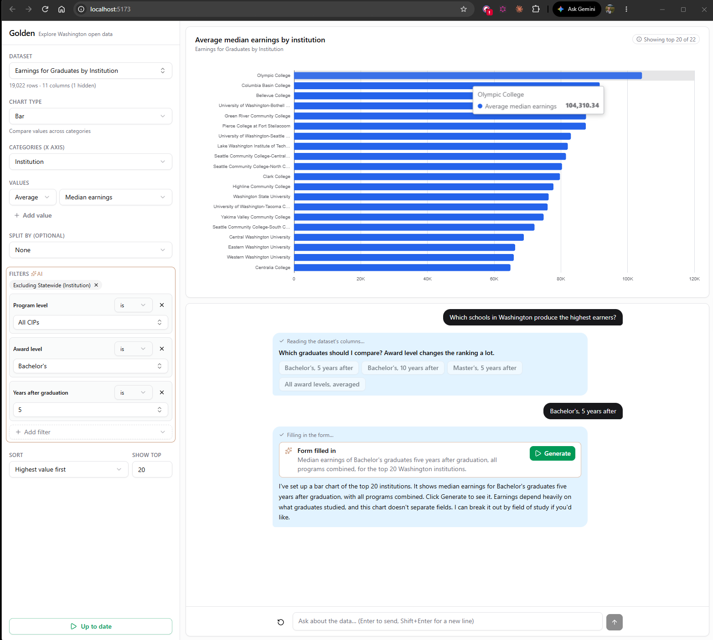
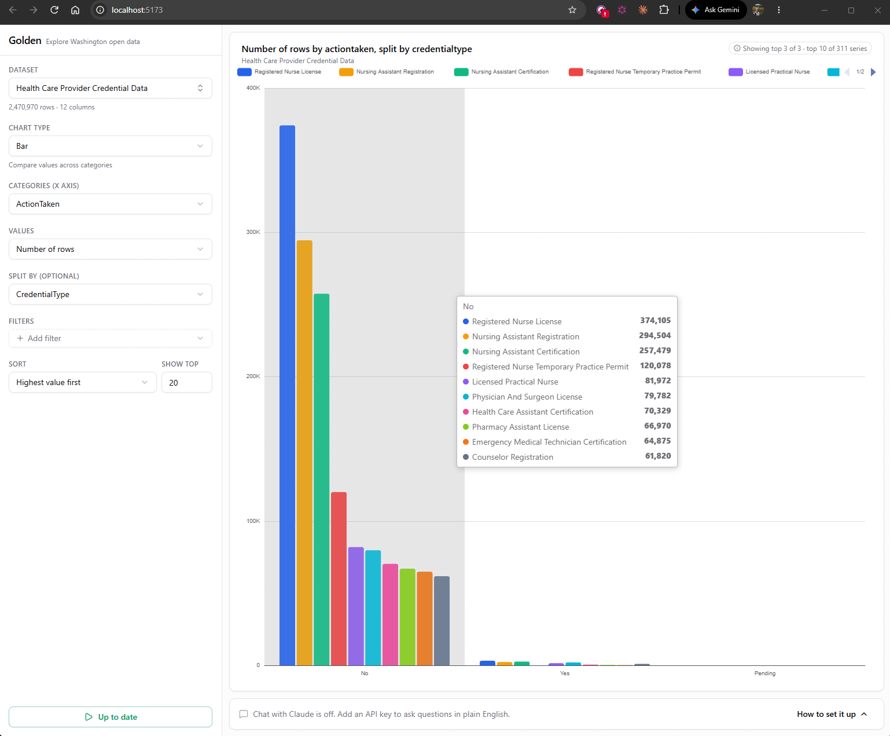

# About

This is a project built to make data easier to understand for non-technical
users as part of the Golden Analytics interview cycle. I looked at the datasets
provided in the email and wasn't really captured by the data, and building a
tool understand and interpret them wasn't exciting. So did some digging and came
up with real world data from Washington state which I built my app around,
opening up just over 1,000 data sets. All data is sourced from
https://data.wa.gov/.

My vision was to create an app which enabled users to ask an AI agent to fetch
data for them based on a question, or build out their own query using a
dynamically generated form. As such there are two primary ways to build a data
visualization:

1. Build your own query using the form on the left-hand portion of the app, or
2. Chat with an AI agent

If an AI agent is used, it populates a form used to generate a query to fetch
the data. This allows users to customize and play with their query on their own
outside of an agent context. I added a few checks in place to avoid matching
incompatible chart types and data types, but outside of that I wanted users to
be free to explore the data without too many hoops to jump through.

The app also works without any API keys as a more basic flow. If a user adds
their Claude API key to the .env file they can start benefiting from AI assisted
searches and conversations. Additionally, if someone using this app takes the
time to setup a API key for the Washington State data, then they can increase
their query limit before experiencing any throttling.

Example of running without an AI key:

The vast majority of my time was spent writing up a spec sheet describing what I
wanted, once I had that written up I used that as my initial prompt to detail a
plan, and then work went fairly quickly from there executing it. My initial
prompt is saved here in this repo as project.md, and then the projectOutline.md
and plan.md were generated after a few discussion with an AI agent. Once the app
was built, follow up prompts focused on UI tweaks and changes, along with adding
in some nice to have features (tooltips and layout improvements). In an effort
to avoid having the AI dictate what and why things were made, I didn't provide
any details as to the nature of the interview nature of this project, or the
original prompt I received via email. After I had finished creating everything
the way I wanted, I pulled back the hood and gave the agent the original prompt
I received in the email to verify that I had covered anything and wasn't missing
any project details. This README I wrote solo.

While actual development time was well under 45 minutes, my own brainstorming
and planing portion of the process did push this over the suggested 45 minute
time. I wanted to be as detailed and thorough in my initial prompt as I could.
To be fair I was having quite a bit of fun with it: exploring data sources was
interesting, and dreaming of what I wanted to create was not something I was
interested in rushing along.

# Getting started:

Note: Node 24 is required From a terminal currently in the project folder:

- `npm install`
- copy .env.example into a .env file
- Optionally: Add a claude api key to .env
  (https://platform.claude.com/settings/keys) - keys are included with claude
  Max, Ultra, and Team plans
- Optionally: to increase the number of API calls you can make you can signup
  for a free API key and add them to your .env file
  (https://evergreen.data.socrata.com/profile/edit/developer_settings)
- `npm run dev`
- Navigate to the port specified in the terminal and begin using the app (most
  likely http://localhost:5173)

# Future improvements given more time

- Let users manually generate queries, i.e. a way to “look under the hood” of
  how queries are being generated and enable them to manually code them
- The ability to “remember” previous queries
- UI improvements to the various charts
- Exporting/saving generated charts
- Adjusting the styling of the chart (color pallet options etc), as well as
  improving readability when there are many data points and text is small
- Using a legend, users can filter the data or hide some fields (this is only
  done with the query builder currently). Legends in general could use some
  improvements to styling, sizing, and placement.
- Enable locally run agents, as well as logging in with popular agents with a
  refined ui flow. This app is intended for non technical users, but getting and
  setting up an API key and running the app don't fit that bill. Deploying this
  to be actually useful to non-devs would require a flow for someone without the
  know how for these tools to get up an running with an AI agent without access
  to a .env file.
- Supporting more data organizations beyond just washington state
- Joining multiple datasets in a query
- Improved error handling. When submitting a query a response can carry
  something like "Value 1: "25th percentile earnings" is not a numeric quantity,
  so aggregating it isn't meaningful. Use "\*" (count rows) or a measure
  column." which might be better simplified using the embedded AI agent
- Better native prompts based on data set chosen. Currently the default prompts
  are the same for each session, but it would be better if these were
  dynamically populated based on a dataset that the user selected
- Testing. I left this out due to time constraints, I've done manual QA work but
  code should be tested
- Do more QA work to fix bugs which I may have missed
- Support SODA 3 along with the current SODA 2.1
- Setup a more robust cache to make queries feel faster. Currently responses
  from the .gov website take up to 6 seconds to respond, and ideally I would
  like to spend time reducing this as much as possible
- Enable resizing of charts
- Improve default chart naming, and enable editing a chart name
