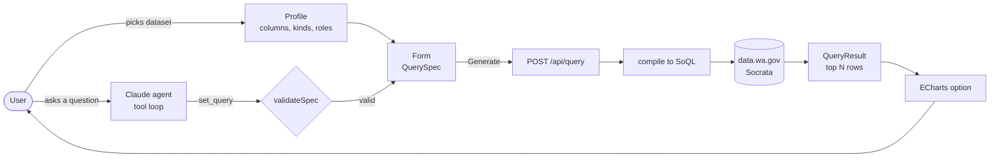

# Golden Interview Playbook

Everything needed to present the app and work on it afterwards: what it is
built from, how a question becomes a chart, where Claude comes in, and what to
say about its strengths and gaps.

## Contents

- [The pitch](#the-pitch)
- [30-minute demo run sheet](#30-minute-demo-run-sheet)
- [Technology stack](#technology-stack)
- [How data flows](#how-data-flows)
- [Where Claude fits](#where-claude-fits)
- [Third-party libraries](#third-party-libraries)
- [Strengths](#strengths)
- [Weaknesses](#weaknesses)
- [Numbers to know](#numbers-to-know)
- [Likely questions](#likely-questions)
- [Working session ideas](#working-session-ideas)
- [Before you start](#before-you-start)

## The pitch

**Golden turns a plain-English question about public data into a chart,
without SQL.** It covers all 1,076 datasets on data.wa.gov, Washington State's
open data portal, so it isn't tied to one dataset.

There are two ways in. You can build the query yourself in a form that adapts
to whichever dataset you pick, or you can ask Claude, which asks a clarifying
question if needed and then fills in that same form. Nothing runs until you
click Generate, so you always see and control what the AI decided. The app
works fully without an AI key.

Three ideas to keep coming back to:

- **Generality:** any dataset, no per-dataset code.
- **The AI fills a form you can check:** human in the loop, nothing hidden.
- **Guardrails for non-technical users:** it won't let you build a misleading
  chart.

## 30-minute demo run sheet

Times are cumulative minutes into the slot.

| Time | Section | What to show and say |
| --- | --- | --- |
| 0–3 | The problem and the user | The "smart but stuck" person from the brief. Why data.wa.gov over the provided datasets: real, messy data, and over a thousand datasets proves the design generalizes. |
| 3–9 | Manual flow | Search for a dataset (instant). The form builds itself from the dataset's columns. Pick a chart type that doesn't fit and show the hard stop. Show the "Excluding Statewide" chip and why it prevents double counting. Generate. Change a field and show the stale notice. The chart section sizes itself to the chart. |
| 9–16 | AI flow | Click a suggested question. Claude asks a clarifying question with buttons, then fills the form with AI-filled fields outlined. Review and Generate. Send a follow-up ("only Bachelor's degrees"). Ask something the data can't answer, such as a percentage of students, and show that Claude says so. |
| 16–20 | Guardrails on an unfamiliar dataset | Open the salmon dataset. Stock Number and Year aren't offered as values, Abundance can be summed, earnings columns can't be. Explain the three layers: name heuristics, a one-time Haiku classification, notes files. |
| 20–25 | Under the hood | The QuerySpec contract shared by form, AI and server. The AI never writes SQL. Aggregation happens in Socrata, so responses are small. Caching and cost per question. |
| 25–28 | How you directed the AI | Spec first (`project.md`), then `projectOutline.md` for decisions and `plan.md` as a living document. Examples where you overruled or corrected it: chat below the chart, hidden instead of disabled fields, cutting the SoQL panel and auto-run, the API-credits correction, catching "average of an ID". |
| 28–30 | Gaps and what's next | Name two or three weaknesses yourself, then lead into the working session with the improvement you most want to build. |

## Technology stack

All TypeScript, about 3,900 lines excluding generated UI components: about
1,400 on the server, 2,000 in the client and 500 shared. One page, one route,
two processes in development.

| Layer | Choice | Why |
| --- | --- | --- |
| Runtime | Node 24 | Built-in `.env` loading, so no dotenv package. |
| Client | React 19, Vite 8 | Fast dev server. Vite proxies `/api` to the backend, so there's no CORS setup. |
| UI kit | shadcn/ui (Radix + cmdk), Tailwind v4 | Accessible primitives (selects, popovers, tooltips) owned as source files. |
| Charts | Apache ECharts | Covers bar, line, scatter and pie with good tooltips. Charts weren't the focus; the interaction was. |
| Server | Express 5, run by tsx in watch mode | A thin API that keeps keys off the browser and makes the Socrata and Claude calls. |
| Validation | zod 4 | One QuerySpec schema used by the server, the AI tools, and to generate the JSON schema Claude sees. |
| AI | `@anthropic-ai/sdk` | Sonnet 5.5 for chat with tool use, Haiku 5.5 for one-time column classification. |
| Data | Socrata SODA 2.1 (data.wa.gov) | Works with no key, so reviewers can run it immediately. An optional key raises rate limits. |
| Dev tooling | concurrently, TypeScript project references | `npm run dev` starts both processes. Separate tsconfigs for client and server. |

## How data flows

Everything revolves around one JSON object, the **QuerySpec**: dataset, chart
type, dimension, measures, optional series, filters, sort and limit. The form
edits it, Claude produces it, and the server validates and runs it. Both paths
end at the same Generate button.

### Picking a dataset

1. The search box queries a local index of the whole catalog, built once in
   the background and saved to `.cache/`.
2. Selecting a dataset calls `GET /api/datasets/:id/profile`.
3. The server reads Socrata's column metadata, counts rows, counts distinct
   values where it can, finds real min/max for numbers stored as text, and
   classifies column roles.
4. The profile (cached for an hour) drives which fields, columns and
   aggregations the form offers. `defaultSpec` picks a sensible starting chart.

### Running a query

1. Generate sends the QuerySpec to `POST /api/query`.
2. The server validates it with zod and `validateSpec`, the same rules the form
   uses.
3. `compileQuery` turns it into SoQL (`$select`, `$where`, `$group`, `$order`).
   Text numbers are cast and placeholders like `NULL` are excluded.
4. Socrata aggregates. The server keeps the top N groups and top 10 series and
   returns compact rows (cached for 10 minutes).
5. The client turns rows into an ECharts option, flipping bars horizontal when
   labels are long.

### The chat path

1. The client posts the message, the conversation so far, and the current form
   state to `POST /api/chat`. The server keeps no state; the browser holds the
   history.
2. The agent loop streams Claude's reply back as server-sent events, running up
   to 10 model calls per message.
3. Claude uses tools to read the schema, look up real filter values and search
   datasets. `ask_user` pauses the turn and shows answer buttons.
4. `set_query` is validated. Filter values that don't exist in the data are
   rejected and Claude retries.
5. A valid spec fills the form with highlights. The user clicks Generate,
   unless `AI_AUTO_RUN=true`.

## Where Claude fits

One key, `ANTHROPIC_API_KEY` in `.env`, read once when the server starts. It
never reaches the browser. The client only learns whether AI is on, through
`/api/config`, and shows either the chat or the setup guide.

| Touchpoint | Model | What it does | Code |
| --- | --- | --- | --- |
| Chat agent | Sonnet 5.5 | Clarifies, grounds values, fills the form. Streaming, prompt caching (about 7k tokens reused per step), medium effort, server-side refusal fallback. | `ai/agent.ts`, `ai/tools.ts`, `ai/prompt.ts` |
| Column classifier | Haiku 5.5 | Labels each column as measure, identifier, year or other, lists sensible aggregations, picks the default chart. One structured-output call per dataset, about 2 s, cached on disk. | `ai/classify.ts` |
| Dataset search tool | (used by the agent) | Socrata full-text search that also matches column names, so Claude can find the right dataset for a question. | `soda/catalog.ts` |

**The subscription question.** The app talks to the Claude API, which bills per
token to a Claude Console organization. Max, Ultra and Team plans include
monthly API credits ($100, $200, up to $500) once you link a Console
organization from claude.ai under Billing. Free, Pro and Enterprise users buy
credits in the Console. Anthropic doesn't allow third-party apps to offer "log
in with Claude", which is why the app uses a key.

**Build-time AI versus run-time AI.** The app was built with Claude Code
running Opus 5.5. The app itself uses Sonnet 5.5 and Haiku 5.5 at run time.
Keep the two separate if asked "how does it use AI": one is the development
process, the other is a product feature.

**Cost.** Sonnet 5.5 is $2 per million input tokens and $10 per million output,
with cached input at a tenth of the price. A typical question costs a few
cents. Classification costs a fraction of a cent per dataset, once.

## Third-party libraries

| Library | Role | Integration |
| --- | --- | --- |
| echarts + echarts-for-react | Rendering charts | `lib/chartOptions.ts` builds an option object per chart type from the query rows. `ChartPanel` passes it to `<ReactECharts notMerge>`, which resizes with its container. |
| radix-ui, cmdk (via shadcn/ui) | Selects, popovers, tooltips, command palette | Generated into `components/ui/` and edited like our own code. Selects default to popper positioning (the fix for "Add filter" opening off-screen). cmdk powers dataset search and the value picker. |
| tailwindcss v4 | Styling | Vite plugin, theme tokens in `index.css`, including the app's own `--ai`, `--success` and `--assistant` colors. |
| @anthropic-ai/sdk | Claude API | One shared client in `ai/client.ts`. `beta.messages.stream` for chat, `messages.parse` with a zod output format for classification. |
| zod | Validation and schema | `shared/querySpec.ts`. `z.toJSONSchema` generates the `set_query` tool schema, so Claude and the server share one definition. |
| express | API server | `server/index.ts`: six routes, plus an error handler that maps Socrata timeouts and throttling to friendly messages. |
| react-markdown | Chat replies | Renders Claude's text with a small component map. Escapes HTML by default, which limits XSS risk. |
| lucide-react, clsx, tailwind-merge, cva | Icons and class helpers | Standard shadcn companions. |
| tsx, concurrently | Dev only | Run the server in watch mode and both processes from one command. |

## Strengths

- **Works across over a thousand datasets.** The form, filters and defaults
  come from each dataset's profile. There's no code per dataset; notes files
  are optional hints.
- **The AI shows its work.** Claude fills a form you can read and change,
  marked so you can see which fields it chose. Nothing runs until you click
  Generate. That builds trust and teaches the user how the query works.
- **It degrades gracefully.** Without a Claude key the app does everything
  except chat and explains how to turn chat on. Without a Socrata key it runs
  anonymously.
- **Guardrails against misleading charts.** The hard stop on incompatible chart
  types, sensible aggregations per column (people get a warning for "average of
  an ID" or "sum of median earnings", Claude isn't allowed to build them),
  rollup rows excluded to avoid double counting, clarifying questions, and
  Claude saying when data can't answer a question.
- **Guardrails that steer instead of block.** Columns are classified as
  measures, IDs/codes or years. The form suggests what makes sense (sum earnings
  counts, latest or earliest year, distinct count of IDs) but still lets a user
  pick anything numeric, with a plain-language warning. A wrong classification
  costs a click, not a dead end. The name rules were tested against real column
  names and fixed where they misfired ("Account Balance" used to read as an
  ID).
- **One validated contract.** Form, AI and server all speak QuerySpec, checked
  by the same `validateSpec`. The AI can't send SoQL, so prompt injection can't
  become query injection, and string values are escaped.
- **Fast and light.** Aggregation runs in Socrata, so the browser gets a few
  dozen rows, not thousands. Dataset search takes milliseconds. Profiles,
  queries and classifications are cached.
- **Cost-aware AI.** Prompt caching, a cheap model for classification, results
  cached on disk, and auto-run off by default.
- **Documented decisions.** `project.md` (the spec), `projectOutline.md`
  (decisions), `plan.md` (how the code works) and `promptLog.md` (every
  prompt).

## Weaknesses

Raising a gap yourself and pairing it with a fix reads as judgment.

| Weakness | Detail | If asked |
| --- | --- | --- |
| No automated tests | A deliberate MVP trade-off, verified by running the app. | The core logic is pure functions (`validateSpec`, `compileQuery`, `heuristicRole`), so unit tests with Vitest are the first thing to add. |
| Nothing persists | Charts can't be saved, shared or exported, and a reload loses the chat. | Encoding the QuerySpec in the URL gives sharing and history almost for free. |
| One data source | Only Socrata, only data.wa.gov. | All Socrata code lives in `server/soda/`. Swapping the compiler for SQL (DuckDB, Postgres) would let business users bring their own data, which is Golden's real use case. |
| Profiles can degrade | If the min/max query for a text-stored number fails once, the column is treated as text and the profile is cached for an hour. That caused the "25th percentile earnings is not a numeric quantity" error. | Don't cache a profile built from a failed sub-query, and retry before downgrading the column. |
| Heuristics are guesses | Rollup and placeholder detection are regex rules. Without a Claude key, column roles come from names only (e.g. "Data Series" still reads as a measure). Some datasets need a notes file, as the earnings data did. | The Haiku classification fixes most of this, and wrong guesses now only change what's suggested, not what's allowed. Next step: a script that compares heuristics with Haiku across ~100 datasets so accuracy is measured, not assumed. |
| Limited charts | Four chart types, no maps (many WA datasets are geographic), no table view, top N and 10-series caps. | A table view with CSV export is small; a map is the biggest missing chart. |
| Local only | No hosting, accounts, or per-user keys. Caches are in memory or on local disk. | Hosting needs auth, per-user key handling (or a server key with quotas), and a shared cache such as Redis. |
| Chart accessibility | Charts draw to a canvas and can't be read by screen readers or explored by keyboard. | A data-table fallback fixes this and doubles as a feature. |
| First runs are slower | The first-ever start builds the catalog index (about 45 s, with live search meanwhile). A dataset's first load adds about 2 s for classification. Very large datasets skip distinct counts. | Everything is cached after the first time. |

## Numbers to know

| | |
| --- | --- |
| Datasets searchable | 1,076 on data.wa.gov |
| Dataset search speed | under 20 ms locally, versus 1–6 s from the Socrata catalog API |
| Catalog index | built in about 45 s once, 434 KB on disk, refreshed every 12 hours |
| Column classification | about 2 s and 4,000 tokens per dataset, once |
| Agent limits | 10 model calls per message, 16,000 output tokens per call, at most 2 clarifying questions |
| Query limits | 50,000 grouped rows from Socrata, top N shown (default 20 for bar), 10 series |
| Cache lifetimes | profile 1 hour, query results 10 minutes, filter values 30 minutes |
| Test dataset | Earnings for Graduates by Institution (`gmgy-gm47`), 19,022 rows, 11 columns |
| Code size | about 3,900 lines of TypeScript plus generated UI components |

## Likely questions

**Why not use one of the provided datasets?**
They weren't interesting, and a generic tool is a stronger answer to "a great
solution won't be tied to a single dataset". Real government data is also
messier: numbers stored as text, placeholder values, summary rows mixed with
detail rows.

**Why does the AI fill a form instead of just answering?**
Non-technical users need to trust the answer. A filled form shows exactly what
was measured and filtered, lets them adjust it without starting over, and
teaches them the tool. It also keeps the app useful without AI.

**How do you stop the AI from making things up?**
It can only produce a QuerySpec, which is validated against the real columns.
Filter values are checked against the data and invented ones are rejected. The
system prompt tells it to look values up with a tool and to say when the data
can't answer.

**What happens with a huge dataset?**
Aggregation happens in Socrata, so only grouped rows come back. Expensive
profile steps have 8-second timeouts and are skipped if slow. A
2.4-million-row dataset loads, just without exact distinct counts.

**How would this become Golden's product, with a customer's own data?**
Keep the QuerySpec, the form and the agent. Replace `server/soda/` with a
connector that profiles a CSV, Sheet or database table and compiles QuerySpec
to SQL (DuckDB is a good fit for uploads). Add accounts, saved charts and
sharing.

**Why SODA 2.1 instead of SODA 3?**
SODA 3 requires an app token for every request. 2.1 works anonymously, so
anyone can clone and run the app with no signup. Everything Socrata-specific
is in one folder if that changes.

**How did you make sure you were directing the AI?**
The spec was written before any code and decisions were kept in
`projectOutline.md`. The AI didn't see the interview brief until the end, and
then only to check for gaps. The prompt log shows the corrections.

**What would you test first?**
`validateSpec` and `compileQuery` with table-driven cases, the role heuristics
against real column names, then one end-to-end test of form to chart with
Socrata mocked.

**What would you do differently?**
Pick one answer you believe. Two good candidates: add a table view and URL
sharing before polishing animations, and make profile building more robust to
Socrata failures.

**Is an API key in the browser a security risk?**
Locally, low risk. Hosted, users would be handing keys to your server, which
needs HTTPS, no logging and trust. The app keeps the key server-side in `.env`
for that reason.

## Working session ideas

Sized for a pairing session. Small means about an hour.

| Improvement | Size | Where | Why it's a good pick |
| --- | --- | --- | --- |
| Data table view and CSV export | Small | `ChartPanel.tsx` | Rows are already in `lastRun.result`. Adds accessibility and a "take it to Excel" path. |
| Shareable URL for a chart | Small | `useExplorer.ts` | Serialize the QuerySpec into the URL and restore it on load. Gives sharing, bookmarks and back-button history. |
| Save chart as PNG | Small | `ChartPanel.tsx` | ECharts has `getDataURL`. Fits the storytelling theme. |
| Robust profiles | Small | `soda/profile.ts` | Fixes the known 25th-percentile failure. Good if they want to see you debug. |
| Unit tests for the core | Small | `shared/charts.ts`, `soda/compile.ts` | Add Vitest; pure functions make this quick. |
| Starter questions per dataset | Medium | `ai/classify.ts`, `ChatPanel.tsx` | Ask Haiku for three questions during classification, replacing the fixed earnings suggestions. |
| "Explain this chart" | Medium | `ai/`, `ChartPanel.tsx` | Send the result rows to Claude for a two-sentence takeaway. Moves from visualizing to storytelling. |
| Friendlier validation errors | Medium | `shared/charts.ts`, `QueryForm.tsx` | Plain-language messages with a suggested-fix button. |
| Upload your own CSV | Large | new connector beside `soda/` | Closest to Golden's product. Profile the file, compile QuerySpec to SQL in DuckDB. |
| Map chart | Large | `charts.ts`, `chartOptions.ts` | Many WA datasets have counties or coordinates; needs GeoJSON and a new column kind. |

## Before you start

- [ ] Start `npm run dev` well before the call and open
      `http://127.0.0.1:5173`. On WSL, `localhost` may try IPv6, which Vite
      isn't listening on.
- [ ] Within the hour before, open every dataset you'll show (earnings, salmon,
      electric vehicles) so profiles and classifications are cached.
- [ ] Run each chart once so the queries are cached for the next 10 minutes.
- [ ] If a numeric column ever shows up as text, restart the server. That
      clears the cached profile.
- [ ] Check the Console balance or plan credits, and that the Socrata key is
      set (the server's startup log says so).
- [ ] Close `.env` in the editor before sharing your screen.
- [ ] Don't reload the page mid-demo; it clears the chat. Use the "New
      conversation" button instead.
- [ ] Have the README's no-key screenshot ready rather than restarting the
      server live to show the setup guide.
- [ ] Keep the repo, `promptLog.md` and `project.md` open in tabs for the "how
      did you use AI" part.
